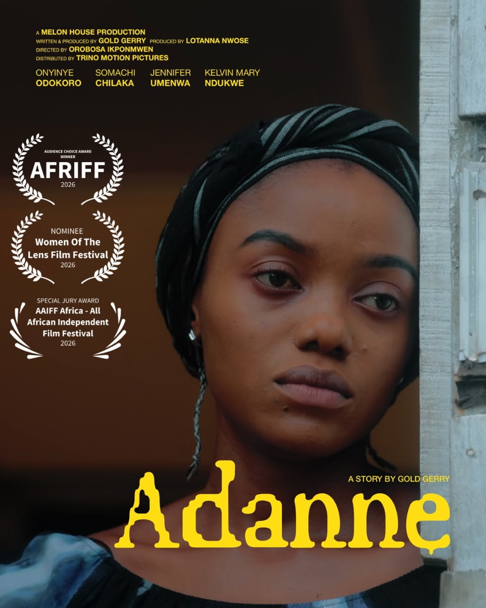
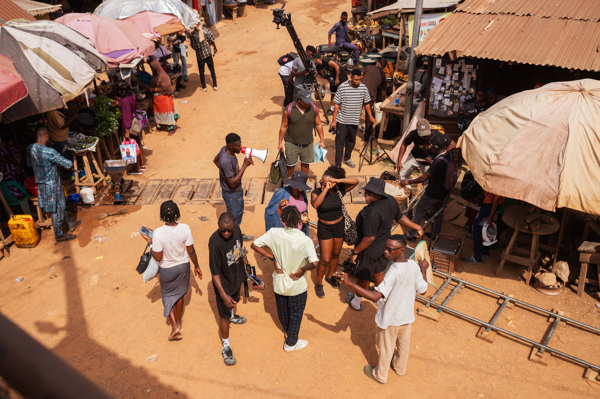
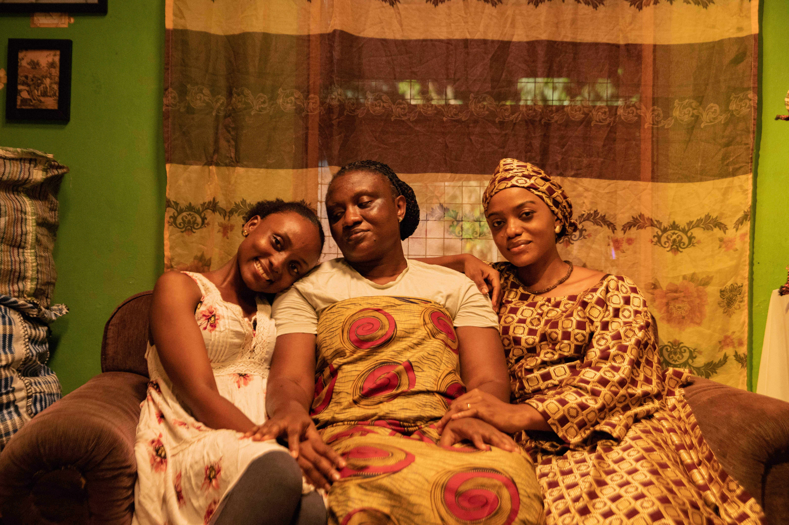

[Adanne](https://www.imdb.com/title/tt40650669/) (2026), the debut feature from director Orobosa Ikponmwen, has won the **AFRIFF 2026 Audience Choice Award**. Festival audiences voted it their favourite film of the 15th Africa International Film Festival in Lagos, and the award was presented at the AFRIFF Globe Awards on 7 November 2026 ([AFRIFF](https://afriff.com)).

It caps a festival run where Adanne was one of the most talked-about titles before a single frame screened. Ahead of AFRIFF 2026, **11 media outlets** named it a film to watch. The audiences then agreed.

Adanne is Melon House's first feature film. It's directed by Orobosa Ikponmwen, written by Gold Gerry, and produced by Gold Gerry and Lotanna Nwose.

## AFRIFF 2026 Audience Choice Award: why it matters

The Audience Choice Award is the one prize at AFRIFF decided by the people in the seats, not a jury. AFRIFF 2026 screened 119 films across 9 categories, and Adanne came out on top with festival audiences.

Past winners include *Son of the Soil* (2025), Skepta's *Tribal Mark* (2024) and Ishaya Bako's *I Do Not Come To You By Chance* (2023). Adanne joins that list as a debut feature from a first-time feature director and a new production company.

> "We made this film hoping it would connect with people, and to know that you have embraced this story in this way is incredibly special. This award belongs to all of you who came out in droves to watch our film, who talked about it, shared your experiences and voted for us."
>
> — **Gold Gerry**, writer and producer of Adanne

## All AFRIFF 2026 Globe Award winners

Adanne won the audience vote ahead of *If I Go Will They Miss Me* and *Which Way*. Here are all the AFRIFF 2026 Globe Award winners:

- **Best Feature Film:** *Slum Bomber*, directed by Maureen Jolly Nankya
- **Special Jury Prize for Outstanding Film:** *Variations on a Theme*, directed by Jason Jacobs and Devon Delmar
- **Audience Choice Award:** ***Adanne***, directed by Orobosa Ikponmwen
- **Best Director:** Olive Nwosu, *Lady*
- **Best Female Actor:** Sarah Karei, *One Woman, One Bra* (directed by Vincho Nchogu)
- **Best Male Actor:** Stevenson Jean, *The Tropic Sun and His Eyes*
- **Best Screenplay:** Elisee Junior St Preux, *The Tropic Sun and His Eyes*
- **Best International Feature:** *The Tropic Sun and His Eyes*, directed by Elisee Junior St Preux
- **Best Documentary:** *Miss Jobson*, directed by Amanda Sans Pantling
- **Special Mention, Documentary:** *For Life*, directed by Ahmet Seven
- **Best Short Film:** *The Spectacular Death of Prisca*, directed by Kaelo Iyizoba
- **Best International Short:** *Little Soldier*, directed by Roxana Karami
- **Best Documentary Short:** *Throne of Wood*, directed by Sadegh Kazemi
- **Best Student Short:** *Sinai America*, directed by Rewan Musa
- **Best Animation:** *Lice n' Shine*, directed by Maria Byoma
- **Pulse Award for Emerging Filmmaker:** Kaelo Iyizoba

See the full list on [AFRIFF's site](https://afriff.com).

## 11 outlets named Adanne a film to watch at AFRIFF 2026

Before the festival opened, Adanne showed up on films-to-watch lists from 11 Nigerian and African media outlets:

1. **What Kept Me Up:** included Adanne in *21 Films to Have on Your Radar at AFRIFF 2026*, noting its jury award at AAIFF in Rwanda ([see the list](https://www.instagram.com/p/DfKUriLjRU5/?img_index=3))
2. **Pulse:** named Adanne a film to watch at AFRIFF 2026 ([see the list](https://www.instagram.com/p/DfPYDkMgvab/?img_index=2))
3. **We Talk Sound:** picked Adanne for its AFRIFF 2026 watchlist ([see the list](https://www.instagram.com/p/DfP5qZeDmWk/?img_index=9))
4. **Saving Cinema:** included Adanne in its AFRIFF 2026 picks ([see the list](https://www.instagram.com/p/DfRtSySiKdZ/?img_index=3))
5. **Titinkori:** listed Adanne among the films to catch at AFRIFF 2026 ([see the list](https://www.instagram.com/p/DfRS9y5grdt/?img_index=4))
6. **Escape Mag HQ:** featured Adanne in its AFRIFF 2026 must-watch list ([see the list](https://www.instagram.com/p/DfRaQ2rkfOZ/?img_index=5))
7. **Binge Buddies:** added Adanne to its AFRIFF 2026 watchlist ([see the list](https://www.instagram.com/p/DfSQyujjNe8/?img_index=3))
8. **Zikoko:** spotlighted Adanne twice in its AFRIFF 2026 coverage ([first list](https://www.instagram.com/p/DfXZzEXAgnI/?img_index=2), [second list](https://www.instagram.com/p/DfUiJ2zgtvs/?img_index=7))
9. **Bounce Networks:** named Adanne a film to watch at AFRIFF 2026 ([see the list](https://www.instagram.com/p/DfUCyCtkQW8/?img_index=3))
10. **Grix Magazine:** included Adanne in its AFRIFF 2026 picks ([see the list](https://www.instagram.com/p/DffjfcdF3i8/?img_index=2))
11. **Amina Magazine:** listed Adanne among its AFRIFF 2026 films to watch ([see the list](https://www.instagram.com/p/DfPUq_3jRou/))

Separately, What Kept Me Up named Adanne one of its *Most Anticipated Nigerian Titles of 2026* back in January.

[Afrocritik](https://afrocritik.com) interviewed the director and producers ahead of the screening: *AFRIFF 2026: In Conversation with Orobosa Ikponmwen, Gold Gerry, and Lotanna Nwose*.

## A sold-out AFRIFF screening

Adanne screened at AFRIFF on 3 November 2026 at FilmHouse Landmark Centre (Screens 1 and 3). It sold out two screens, with 20+ more people watching from the floor. Even then, the rooms hit capacity and some people had to be turned away at the door.

<video controls muted loop playsinline preload="metadata" aria-label="Sold-out Adanne screening at AFRIFF 2026">
<source src="/images/soldout.MOV" type="video/mp4">
<source src="/images/soldout.MOV" type="video/quicktime">
</video>

### What audiences said after the screening:

<blockquote class="twitter-tweet"></blockquote>

<blockquote class="twitter-tweet"></blockquote>

<blockquote class="twitter-tweet"></blockquote>

## What is Adanne about?

Adanne follows three generations of Igbo women: Akachi, Ijeoma and Adanne. Akachi starts a cycle, Ijeoma keeps it going, and Adanne has to decide whether to break it. At its centre is a teenage girl caught between her creative dreams and the traditions she's expected to honour.

### Watch the official teaser:

<iframe width="560" height="315" src="https://www.youtube.com/embed/e1PMpQLayZs" title="Adanne (2026) Official Teaser" frameborder="0" allow="accelerometer; autoplay; clipboard-write; encrypted-media; gyroscope; picture-in-picture" allowfullscreen></iframe>

## Cast and crew

- **Director:** Orobosa Ikponmwen (feature debut)
- **Writer:** Gold Gerry
- **Producers:** Gold Gerry, Lotanna Nwose
- **Director of Photography:** Olayinka Suara
- **Cast:** Mmesomachi Chilaka (Adanne, screen debut), Onyinye Odokoro (Ijeoma), Kelvinmary Ndukwe (Daniel), Jennifer Umenwa (Akachi)
- **Production company:** Melon House

## Adanne's festival run so far

- **AAIFF, Kigali** (October 2026): Jury Mention
- **AFRIFF, Lagos** (November 2026): Audience Choice Award
- **Women of the Lens Festival, London** (November 2026): Best Director nomination for Orobosa Ikponmwen (festival takes place later this month)

See the [AAIFF announcement](https://www.instagram.com/p/DctPRtgjPxc/?igsi=ZW51cnVlZDY1YW5v) and the [Women of the Lens selection](https://www.instagram.com/womenofthelens?igsi=bjcwZDI2ZWRqMTk4). Earlier coverage of the festival run: [The British Blacklist](https://thebritishblacklist.co.uk/out-of-africa-nigerian-family-drama-adanne-released-by-melon-house-productions-embarks-on-international-festival-run/) and [Culture Custodian](https://culturecustodian.com/orobosa-ikponmwens-adanne-gets-aaiff-and-women-of-the-lens-festival-london-selection/).

## What's next for Adanne

Adanne's next stop is the Women of the Lens Festival in London later this month. Cinema release dates will be announced soon.

Follow the film on Instagram at [@adannefilm](https://instagram.com/adannefilm), and log it on [Letterboxd](https://letterboxd.com/film/adanne/) or [IMDb](https://www.imdb.com/title/tt40650669/). Press enquiries: [hello@melonhouse.co](mailto:hello@melonhouse.co).

---

## FAQ

**Who won the AFRIFF 2026 Audience Choice Award?**
Adanne, directed by Orobosa Ikponmwen and produced by Melon House.

**Who directed Adanne?**
Orobosa Ikponmwen. Adanne is her first feature film.

**When is Adanne coming to cinemas?**
Release dates will be announced soon. Follow [@adannefilm](https://instagram.com/adannefilm) for updates.

**Where can I watch Adanne?**
Adanne's next screening is at the Women of the Lens Festival in London this November, which has sold out. Cinema dates will follow.
